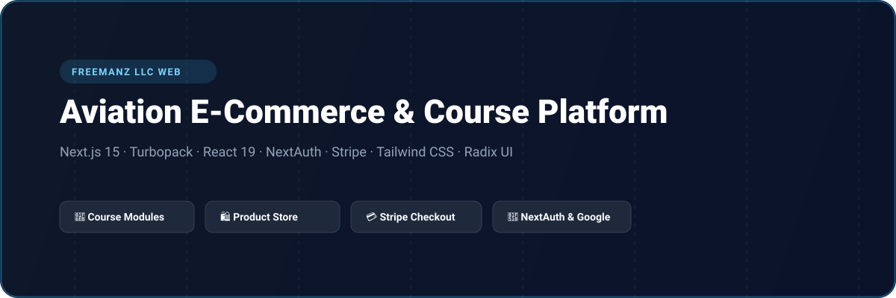
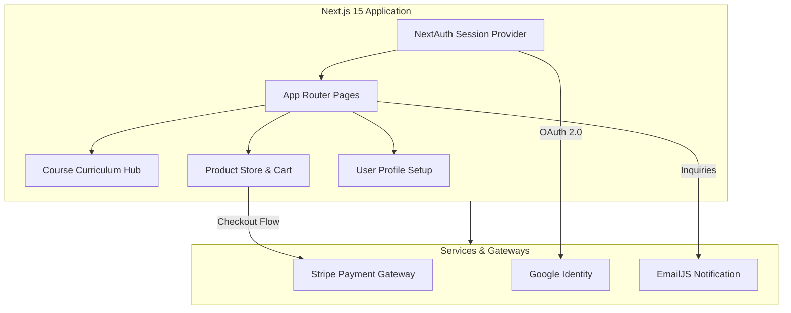

# FreemanZ LLC - Aviation E-Commerce & Course Platform

<p align="center">
  
</p>

<p align="center">
  <a href="https://nextjs.org"></a>
  <a href="https://react.dev"></a>
  <a href="https://next-auth.js.org"></a>
  <a href="https://stripe.com"></a>
  <a href="https://tailwindcss.com"></a>
  <a href="https://radix-ui.com"></a>
  <a href="LICENSE"></a>
</p>

---

## 📖 Overview

**FreemanZ Frontend (`freemanzfly_frontend`)** is a dedicated aviation apparel, equipment, and flight training platform. Built with Next.js 15 (Turbopack) and React 19, the application features user authentication via NextAuth (Google OAuth & credentials), structured flight course curriculum viewers, physical goods e-commerce with cart and Stripe checkout, and profile dashboard management.

---

## ⚡ Key Features

- **🔐 NextAuth Authentication:** Google Social Sign-In, credentials registration, email OTP validation, and secure profile onboarding.
- **🛫 Flight Courses & Modules:** Interactive syllabus viewers and educational video courses for aspiring pilots and aviation enthusiasts.
- **🛍️ Integrated E-Commerce Store:** Product catalog, item variants, cart state management, and streamlined checkout.
- **💳 Stripe Payment Processing:** Seamless transaction settlement for courses and merchandise with order success handling.
- **📱 Modern Responsive Architecture:** Built with Radix UI, Tailwind CSS, Lucide icons, and EmailJS transactional contact support.

---

## 🏗️ System Architecture



---

## 🗂️ Project Structure

```
freemanzfly_frontend/
├── assets/
│   └── banner.svg               # Architectural repository banner
├── src/
│   ├── app/
│   │   ├── (AuthLayout)/        # Login, Signup, OTP, Reset Password
│   │   ├── (default)/           # Product catalog, Course details, Cart, Checkout
│   │   ├── api/auth/            # NextAuth route handler
│   │   ├── globals.css          # Styling tokens
│   │   └── layout.tsx
│   ├── components/              # Shared UI components & navigation
│   ├── assets/                  # Course graphics & brand imagery
│   └── lib/                     # Utilities & auth config
├── package.json
└── tsconfig.json
```

---

## 🛠️ Tech Stack

| Technology | Purpose |
| :--- | :--- |
| **Next.js 15** | Modern App Router with Turbopack bundler |
| **React 19** | React component runtime |
| **NextAuth.js** | Multi-provider authentication and session management |
| **Stripe SDK** | Secure payment checkout integration |
| **Tailwind CSS** | Responsive utility styling |
| **Radix UI** | Accessible UI primitives (dialogs, dropdowns, accordions) |
| **EmailJS** | Client-side contact and support dispatch |

---

## 🚀 Getting Started

### Prerequisites

- Node.js >= 20.0.0
- npm or yarn

### Installation

1. Clone the repository:
   ```bash
   git clone https://github.com/shahjalal-labs/freemanzfly_frontend.git
   cd freemanzfly_frontend
   ```

2. Install dependencies:
   ```bash
   npm install
   ```

3. Configure environment variables:
   ```bash
   cp .env.example .env.local
   ```

4. Start development server:
   ```bash
   npm run dev
   ```
   Open [http://localhost:3000](http://localhost:3000) to view the application.

---

## 📄 License

This project is licensed under the [ISC License](LICENSE).
